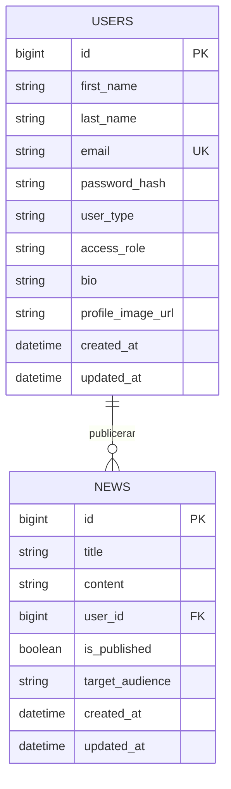

# Databasschema

Databasen `school_intranet` används för att hantera användare och nyheter i skolans intranät.

## Diagram

## Tabeller

| Tabell | Innehåll |
| ------ | -------- |
| `users` | Lagrar användarnas personuppgifter, inloggningsuppgifter, användartyp och behörighet. |
| `news` | Lagrar nyheter på intranätet, inklusive författare, publiceringsstatus och målgrupp. |

## Relationer

| Relation | Beskrivning |
| -------- | ----------- |
| `users` → `news` | En användare kan publicera flera nyheter. |
| `news.user_id` → `users.id` | Varje nyhet tillhör en användare. |

## Användartyper och behörigheter

Tabellen `users` innehåller två separata fält för användartyp och behörighet.

### user_type

| Värde | Beskrivning |
| ----- | ----------- |
| `STUDENT` | Student på skolan. |
| `TEACHER` | Lärare eller personal på skolan. |

### access_role

| Värde | Beskrivning |
| ----- | ----------- |
| `USER` | Vanlig användare. |
| `ADMIN` | Administratör med utökade behörigheter. |

## Nyheternas målgrupp

Fältet `target_audience` i tabellen `news` styr vilka användartyper en nyhet riktar sig till.

| Värde | Beskrivning |
| ----- | ----------- |
| `ALL` | Nyheten riktar sig till alla användare. |
| `STUDENT` | Nyheten riktar sig till studenter. |
| `TEACHER` | Nyheten riktar sig till lärare och personal. |

Fältet `is_published` avgör om en nyhet är publicerad eller ett utkast.

## Databasregler

- `users.email` måste vara unikt.
- `users.user_type` har standardvärdet `STUDENT`.
- `users.access_role` har standardvärdet `USER`.
- `news.is_published` har standardvärdet `FALSE`.
- `news.target_audience` har standardvärdet `ALL`.
- Varje nyhet måste ha en giltig användare som författare.
- En användare kan inte raderas om användaren har kopplade nyheter (`ON DELETE RESTRICT`).
- Lösenord lagras som hashvärden, inte i klartext.

## Index

| Index | Tabell | Kolumner | Syfte |
| ----- | ------ | -------- | ----- |
| `idx_news_user_id` | `news` | `user_id` | Effektiv sökning av nyheter per användare. |
| `idx_news_published_created` | `news` | `is_published`, `created_at` | Effektiv hämtning och sortering av publicerade nyheter efter datum. |

## Versioner

| Version | Datum | Ändring | Varför |
| ------- | ----- | ------- | ------ |
| 1 | 2026-10-22 | Dokumenterade databasschemat med tabellerna `users` och `news`. | Stöd för användarhantering och nyhetspublicering. |
| 2 | 2026-10-22 | Lade till `target_audience` i tabellen `news`. | Möjliggöra målgruppsanpassade nyheter för studenter och lärare. |
